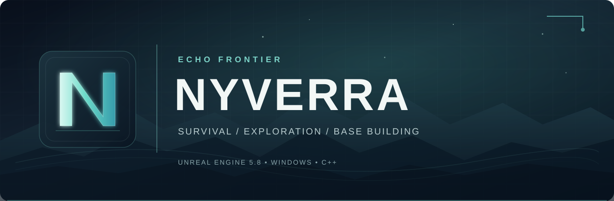

<div align="center">



<br>

**NYVERRA: Echo Frontier** — многопользовательский survival-проект на Unreal Engine 5.8.

Исследование • Выживание • PvPvE • Строительство баз

<br>

[](CHANGELOG.md)
[](https://www.unrealengine.com/)
[](docs/DEVELOPMENT.md)
[](Source/NYVERRA/)
[](https://github.com/Zeihos/NYVERRA-Echo-Frontier/actions/workflows/nyverra-offline.yml)

<br>

[**Начать работу**](#-быстрый-старт) · [**Возможности**](#-возможности) · [**Дорожная карта**](docs/ROADMAP.md) · [**Документация**](docs/README.md) · [**Сообщить об ошибке**](https://github.com/Zeihos/NYVERRA-Echo-Frontier/issues)

</div>

---

> **Текущий этап — Alpha 0.61, не релиз.** В репозитории находится исходный код прототипа, а не готовая игра для скачивания. Последние изменения ещё не прошли подтверждённую сборку Unreal Engine 5.8 и полноценные мультиплеерные испытания. Статус в GitHub Actions относится **только к офлайн-проверкам Python и структуры исходников**.

## ◈ О проекте

**NYVERRA: Echo Frontier** — проект сетевой игры на выживание для Windows. Игрокам предстоит исследовать опасный мир, добывать ресурсы, поддерживать состояние персонажа, строить укрытия и защищать базы от других выживших и противников.

Сейчас разрабатывается техническая основа: персонаж, взаимодействия, экономика ресурсов, строительство, серверная логика и сохранение построек. Визуальные материалы, уровень, анимации и полноценная серверная инфраструктура продолжают дорабатываться.

## ◈ Возможности

| Выживание | Мир и взаимодействия | Строительство и PvP |
| :--- | :--- | :--- |
| Здоровье, голод, жажда, выносливость | Добыча дерева, камня, воды и других ресурсов | Фундаменты, стены, запираемые двери |
| Инвентарь, предметы и крафт | Контейнеры с добычей, PvE-противники | Прочность построек, ремонт и рукопашные рейды |
| Потребление еды и воды | Прототип окружения и игровых локаций | Сетевые проверки действий на сервере |

<sub>Перечислены системы, присутствующие в исходниках **на стадии прототипа**. Наличие механики в коде не гарантирует отсутствие ошибок в игре.</sub>

### Что появилось в Alpha 0.61

**Сохранение баз с защитой от повреждения:** сервер чередует два слота A/B, проверяет версии и ревизии, затем пытается восстановить последнюю корректную копию мира. Сохраняются фундаменты, стены и двери — **но не персонажи и их инвентари**.

[История версий](CHANGELOG.md) · [Текущая готовность](docs/STATUS.md)

## ◈ Быстрый старт

<sub>Windows 10/11 · Unreal Engine 5.8 · Visual Studio с поддержкой C++/Unreal · Git · Python 3</sub>

```bat
git clone https://github.com/Zeihos/NYVERRA-Echo-Frontier.git
cd NYVERRA-Echo-Frontier
CHECK_PROJECT_WINDOWS.bat
```

Скрипт запускает офлайн-регрессионные проверки и **пытается** собрать `NYVERRAEditor`. Если Unreal Engine находится в нестандартной папке:

```bat
CHECK_PROJECT_WINDOWS.bat "D:\Epic Games\UE_5.8"
```

После успешной сборки открой `NYVERRA.uproject` в Unreal Editor.

**Важное ограничение:** проверенная карта `Content/Maps/TestWorld.umap` пока отсутствует в GitHub. Для создания локальной тестовой карты есть `BUILD_AND_PREPARE_ALPHA_053_WINDOWS.bat`. Это не замена полноценной игровой карте.

[Подробная инструкция по сборке и тестированию](docs/DEVELOPMENT.md)

## ◈ Управление прототипом

| Действие | Клавиши |
| :--- | :--- |
| Передвижение, обзор, бег, прыжок | WASD, мышь, Shift, Space |
| Атака / взаимодействие | ЛКМ / E |
| Инвентарь / курсор | I / Tab |
| Еда и вода | F / Q |
| Фундамент / стена / дверь | 1 / 2 / 5 |
| Топор / кирка | 3 / 4 |
| Ремонт своей постройки | R |

Указаны привязки из исходников. Поведение на сетевом сервере требует проверки.

## ◈ Разработка

```text
NYVERRA-Echo-Frontier/
├── Source/NYVERRA/     игровая логика на C++
├── Config/             настройки Unreal
├── Content/            ассеты и исходные материалы
├── Tools/              тесты, генераторы и утилиты
├── Documentation/      GDD и техническое задание
├── docs/               актуальная документация
├── History/            исторические прототипы
├── .github/            проверки и шаблоны
└── NYVERRA.uproject
```

**Навигация по проекту:** [документация](docs/README.md) · [план разработки](docs/ROADMAP.md) · [изменения](CHANGELOG.md) · [архив старых Alpha](docs/archive/README.md) · [участие](CONTRIBUTING.md) · [безопасность](SECURITY.md)

## ◈ Статус публикации

Проект **открыт для просмотра в GitHub**. Публичный репозиторий **не означает свободную лицензию**: условия использования кода и ассетов ещё не определены владельцем. Не добавляйте в Issues и Pull Requests приватные сохранения `Saved/`, пароли, токены или персональные данные.

<div align="center">

<sub>NYVERRA: ECHO FRONTIER · Разработка: <a href="https://github.com/Zeihos">Zeihos</a></sub>

<sub>Фирменная обложка выше — оформление проекта, а не изображение игрового процесса.</sub>

</div>
